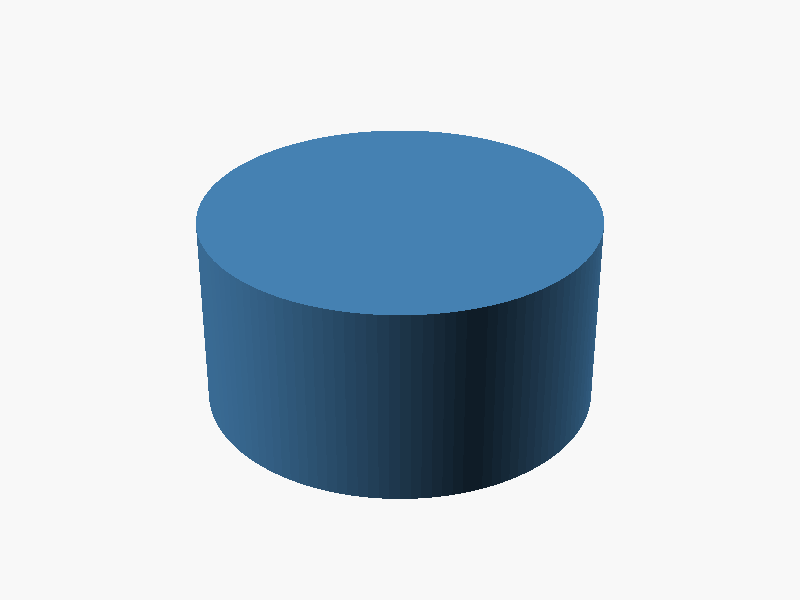

# build123d-template

A Cookiecutter template for build123d CAD projects: a parametric part, STL and
STEP export, the OCP CAD Viewer for VS Code, and CI that checks the code and
builds the parts on every push and publishes them on each release tag.



## Quickstart

### Create Project from Cookie Cutter Template

```bash
uv tool install cookiecutter
cookiecutter https://github.com/CameronBrooks11/build123d-template.git
```

You will be prompted for six values—here’s how to fill them:

- **project_name**  
  The name of your project directory and GitHub repo. Use hyphens, not spaces (e.g. `my-cad-project`).

- **package_name**  
  The Python import name. Must be a valid identifier (lowercase, underscores only). The default is `project_name` in lowercase with hyphens replaced by underscores (e.g. `my_cad_project`); press Enter to accept it.

- **author_name**  
  Your full name for metadata (e.g. `Jack Daniel`).

- **email**  
  Your contact email (e.g. `jdrocks@email.com`).

- **version**  
  Typically this should be the initial version using [SemVer](https://semver.org/) (e.g. `0.1.0`).

- **project_description**  
  A short, descriptive tagline for your project (e.g. `A build123d CAD project for robotics prototypes`).

Next navigate into your newly created project using the `project_name` you entered:

```bash
cd project_name
```

### Initialize Git and make your first commit

Start by initializing a new git repository and commit the initial contents of your newly created project template:

```bash
git init
git add .
git commit -m "Initial cookiecutter scaffold"
```

### Method 1: Using GitHub CLI (API auth)

If you have the GitHub CLI installed and authenticated via `gh auth login`, run:

```bash
gh repo create OWNER/project_name --public --source . --remote origin --push
```

### Method 2: Using HTTPS & Personal Access Token

If you prefer standard Git commands, do:

```bash
git branch -M main
git remote add origin https://github.com/OWNER/project_name.git
git push -u origin main
```

> You will be prompted for your GitHub username and a personal access token (PAT) when pushing over HTTPS.

## Usage

A generated project uses [uv](https://docs.astral.sh/uv/) for its environment and
[just](https://just.systems/) for its tasks. The examples use the package name
`my_cad_project`.

### 1. Install the project

From the project root:

```bash
just setup
```

This runs `uv sync`, which creates `.venv` with build123d, the project itself
(editable, so `my_cad_project` imports from anywhere) and the dev tools ruff and
pyright.

### 2. Build a part

```bash
uv run python -m my_cad_project.part1
```

The script builds the part, shows it in the OCP CAD Viewer if the viewer is
running in VS Code, and exports `part1.stl` and `part1.step` to `build/` in the
project root. `just parts` runs every module in the package the same way.

### 3. Check the code

```bash
just check
```

This checks formatting, lints with ruff and type-checks with pyright. `just fmt`
fixes the formatting and import order.

### 4. Add a part

Copy `part1.py` to a new module, such as `part2.py`, in the package. Keep the
`Spec` dataclass and `make_part` function, and run it with
`uv run python -m my_cad_project.part2`.

## CI and releases

`lint-and-test.yml` runs `just check` and `just parts` on every push.
`cad-release.yml` runs on tags starting with `v`: it runs the same recipes, then
publishes a release with each file in `build/` attached, named with the tag
(for example `part1-v0.1.0.stl`).

## Licence

The template is MIT; see [LICENSE](LICENSE). A generated project gets an MIT
`LICENSE` naming the author you enter.
